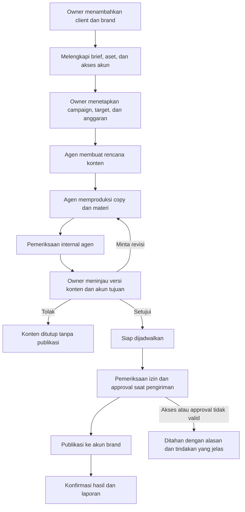

# PRD Rewrite — AI Creative Agency

Tanggal: 2026-10-25  
Status: Draft untuk review produk; belum menjadi kontrak implementasi  
Basis: Paperclip existing, diarahkan untuk operasional creative agency pengelola sosial media brand.

## 1. Ringkasan produk

Produk menjadi ruang kerja creative agency yang dijalankan oleh owner manusia dan tim agen AI. Owner mengelola beberapa klien dan brand, menetapkan strategi serta anggaran, meninjau hasil produksi, dan menyetujui konten sebelum dipublikasikan ke akun sosial media milik brand.

Company mewakili agency. Company bukan owner manusia dan bukan brand pelanggan. Owner adalah pengguna dengan kewenangan pengelolaan agency. Klien tetap memiliki akun sosial medianya dan memberikan akses pengelolaan kepada agency.

Keputusan eksplisit pengguna: **approval konten hanya dilakukan owner agency; approval klien tidak diperlukan**. MVP tidak membutuhkan portal, akun login, atau antrean approval untuk klien.

Dokumen ini adalah usulan perubahan arah produk, bukan pernyataan bahwa seluruh kemampuan sudah tersedia. Dokumen strategis dan kontrak V1 existing tetap berlaku sampai perubahan implementasi disepakati dan kontraknya diperbarui.

## 2. Masalah yang diselesaikan

Owner agency harus mengoordinasikan banyak brand dengan brief, gaya komunikasi, aset, target, dan akun sosial berbeda. Produksi konten memerlukan pembagian kerja, revisi, penjadwalan, publikasi, serta laporan yang dapat ditelusuri.

Fondasi existing mengelola company, agen, proyek, tugas, hasil kerja, biaya AI, dan governance. Konteks bisnis agency perlu menjadi objek yang jelas agar pekerjaan tidak hanya berupa daftar tugas umum dan konten tidak tertukar antarbrand.

## 3. Tujuan dan ukuran keberhasilan

1. Owner dapat menjalankan satu agency dengan beberapa klien, brand, kampanye, dan akun sosial.
2. Tim agen memproduksi konten berdasarkan brief dan panduan brand yang berlaku.
3. Owner dapat mengambil keputusan konten dari satu antrean dengan preview dan versi yang jelas.
4. Hanya konten dengan persetujuan owner yang masih valid dapat dipublikasikan.
5. Hasil publikasi, kendala, dan biaya AI dapat ditelusuri ke brand dan pekerjaan terkait.

| Ukuran | Definisi | Kriteria awal |
|---|---|---|
| Pelanggaran approval | Publikasi tanpa approval owner yang valid untuk versi dan tujuan publikasi | 0 |
| Kesalahan akun | Publikasi ke akun di luar target yang disetujui | 0 |
| Publikasi ganda akibat retry | Post duplikat untuk satu pekerjaan publikasi | 0 |
| Waktu produksi | Durasi brief siap sampai diajukan ke owner | Diukur saat pilot; target ditetapkan setelah baseline |
| Ketepatan jadwal | Publikasi terkonfirmasi dalam toleransi jadwal yang ditetapkan pilot | Dilaporkan bersama kegagalan dan pengecualian |
| Biaya produksi | Biaya AI tercatat per brand, kampanye, dan konten | Tampilkan biaya tidak diketahui secara eksplisit |

Angka peningkatan produktivitas dan toleransi waktu publikasi belum ditetapkan oleh pengguna.

## 4. Pengguna dan kewenangan

| Aktor | Tanggung jawab | Batas |
|---|---|---|
| Owner agency | Mengelola klien, brand, akun, agen, anggaran, dan keputusan publikasi | Hanya dalam company yang diizinkan |
| Account manager AI | Melengkapi brief, mengoordinasikan pekerjaan, merangkum progres | Tidak dapat mengesahkan approval owner |
| Strategist AI | Membuat strategi, pilar konten, dan kalender | Tidak dapat mempublikasikan tanpa izin yang sah |
| Creative Strategist AI | Memberikan insight dan ide konten kepada owner: angle, hook, format, referensi, alasan relevansi brand, serta prioritas eksperimen | Tidak menyetujui atau mempublikasikan ide; referensi dan hipotesis harus dibedakan dari data yang terverifikasi |
| SEO AI | Meneliti keyword dan search intent, menyusun brief konten SEO, mengaudit halaman yang diizinkan, dan merekomendasikan optimasi | Tidak mengubah website atau mempublikasikan tanpa approval owner dan akses yang sah; tidak menjanjikan ranking |
| Marketing AI | Menyusun target audiens, positioning, penawaran, campaign brief, rencana distribusi, dan eksperimen pemasaran | Tidak membelanjakan anggaran iklan, meluncurkan paid ads, atau mempublikasikan tanpa kewenangan; eksekusi paid ads di luar MVP |
| Copywriter AI | Menulis caption, naskah, CTA, dan variasi | Mengikuti brief serta versi panduan brand |
| Designer / creative AI | Menyiapkan visual atau brief aset | Kemampuan produksi mengikuti tool yang tersedia |
| Publisher AI / layanan publikasi | Mengirim konten yang sudah disetujui sesuai jadwal | Memeriksa ulang approval, akun, dan otorisasi sebelum mengirim |
| Analyst AI | Merangkum hasil berdasarkan data yang tersedia | Tidak mengarang metrik yang belum tersedia |
| Klien / pemilik brand | Memberikan brief, aset, dan otorisasi akun melalui agency | Tidak menjadi aktor approval atau pengguna aplikasi di MVP |

Role agen adalah tanggung jawab operasional; bukan kewenangan otomatis. Grant koneksi, akses brand, dan kebijakan company tetap menentukan tindakan yang boleh dijalankan. Satu agen boleh merangkap beberapa peran pada agency kecil.

## 5. Model bisnis dan objek utama

```text
Company / Agency
├── Owner manusia
├── Tim agen AI
└── Client
    └── Brand
        ├── Profil, panduan, dan aset brand
        ├── Akun sosial media
        └── Project / Campaign
            └── Content Item
                ├── Tugas produksi dan revisi
                ├── Versi materi
                ├── Keputusan owner
                └── Publication per akun tujuan
```

| Objek | Makna dan aturan |
|---|---|
| Company | Batas agency dan isolasi data utama; satu instance tetap dapat memiliki beberapa company |
| Client | Organisasi atau pelanggan agency; memiliki satu atau lebih brand |
| Brand | Identitas bisnis yang dikelola; memiliki audiens, bahasa, tone, tujuan, dan aset sendiri |
| Social Account | Identitas akun provider yang diotorisasi untuk satu brand; credential disimpan melalui sistem koneksi existing |
| Project / Campaign | Inisiatif brand, misalnya kampanye peluncuran atau pengelolaan konten November |
| Content Item | Satu materi kreatif yang dikerjakan dan direview; dapat memiliki beberapa varian platform |
| Content Revision | Snapshot caption, aset, format, serta varian tujuan yang dapat direview |
| Owner Decision | Persetujuan, permintaan revisi, atau penolakan terhadap snapshot tertentu |
| Publication | Satu pengiriman versi konten ke satu akun tujuan, dengan jadwal dan hasil provider |

Seluruh objek memiliki scope company. Relasi client, brand, campaign, akun, tugas, dan konten harus konsisten dalam company yang sama. MVP menggunakan satu brand per campaign dan satu brand per akun terdaftar. Relasi lintas brand tidak dibuat otomatis.

Client tidak memiliki company tersendiri. Client dan Brand tetap objek berbeda agar satu pelanggan dapat memiliki beberapa brand. Proyek internal agency boleh tetap tanpa brand; fitur publikasi membutuhkan konteks brand yang lengkap.

Retainer, paket layanan, kuota konten, dan harga jasa dapat menjadi metadata operasional di tahap berikutnya. Invoice, pembayaran, pajak, dan akuntansi laba tidak masuk MVP. Biaya AI tidak disebut sebagai total biaya atau margin agency.

## 6. Alur bisnis utama



### 6.1 Onboarding client dan brand

Owner membuat client dan brand, melengkapi produk, target audiens, tujuan pemasaran, bahasa, tone of voice, batasan klaim, referensi, dan aset. Agen boleh membantu menyusun draft; data yang belum diketahui ditandai sebagai belum lengkap.

Owner menghubungkan akun melalui koneksi resmi yang didukung. Sistem menampilkan identitas akun sebenarnya, kemampuan yang tersedia, dan status akses. Mengisi username saja tidak dianggap sebagai akun siap publikasi. Rahasia autentikasi tidak disimpan di brief, komentar, atau prompt.

### 6.2 Perencanaan dan produksi

Owner menetapkan campaign dan brief, termasuk periode, deliverable, target akun, serta anggaran AI. Agen menyusun pilar dan rencana konten, kemudian membagi tugas produksi. Rencana tidak memperoleh approval publikasi secara otomatis; setiap versi konten tetap harus disetujui owner.

Marketing AI menerjemahkan tujuan bisnis brand menjadi target audiens, pesan, penawaran, CTA, kanal distribusi, dan metrik campaign. Strategist AI mengubah arahan tersebut menjadi pilar serta kalender konten. SEO AI memasok riset keyword, search intent, kelompok topik, dan brief yang relevan untuk konten organik. Copywriter dan designer menggunakan brief tersebut untuk produksi; account manager mengoordinasikan handoff serta kelengkapan hasil.

Creative Strategist AI membantu owner memilih ide sebelum produksi. Agen menerima brief brand, tujuan campaign, insight SEO/marketing, dan data performa yang tersedia. Hasilnya berupa shortlist ide dengan judul, insight audiens, angle, hook pembuka, format/platform, outline visual atau cerita, CTA, alasan kesesuaian brand, kebutuhan aset, usaha produksi, dan ukuran keberhasilan. Referensi mencantumkan sumber; gagasan tren yang belum diverifikasi ditandai sebagai hipotesis. Owner dapat memilih, meminta pengembangan, atau mengarsipkan ide melalui tugas/dokumen existing. Ide yang dipilih menjadi brief produksi tertaut; pemilihan ide tidak menggantikan approval versi konten sebelum publikasi. Designer bertanggung jawab pada pembuatan aset, sedangkan Creative Strategist pada konsep dan insight.

Tugas mengikuti single-assignee existing. Review atau handoff memindahkan tanggung jawab melalui mekanisme tugas yang sah. Agen membuat draft, melakukan pemeriksaan internal, dan mengajukan preview beserta caption, aset, tujuan akun, dan jadwal yang diusulkan.

### 6.3 Approval owner

Owner memilih Setujui, Minta revisi, atau Tolak. Minta revisi menyertakan arahan yang diteruskan ke agen. Tolak menutup versi konten tanpa menerbitkannya; pengajuan ulang membutuhkan versi baru.

Persetujuan mengikat revision, varian platform, aset, caption, akun tujuan, dan jadwal atau pilihan tanpa jadwal yang ditampilkan. Perubahan salah satu bagian tersebut setelah disetujui membatalkan kelayakan publikasi dan memerlukan persetujuan ulang. Persetujuan menyimpan identitas owner, waktu, dan snapshot yang diputuskan.

Untuk MVP, perubahan panduan brand menandai konten belum terbit sebagai perlu pemeriksaan ulang; owner mengesahkan ulang versi yang masih sesuai. Approval batch, approval otomatis oleh agen, dan delegasi approver manusia lain ditunda.

Approval owner untuk konten tidak menggantikan gate koneksi, anggaran, governance, atau izin provider. Agen tidak dapat memperoleh kewenangan owner lewat instruksi dalam brief atau komentar. Jika ada beberapa pengguna dengan role owner, satu keputusan owner yang sah cukup; kuorum tidak diperlukan di MVP.

### 6.4 Penjadwalan dan publikasi

Owner dapat menyetujui untuk langsung dikirim atau dijadwalkan. Jadwal disimpan sebagai waktu absolut dan ditampilkan dalam timezone brand. Perubahan timezone tampilan tidak menggeser jadwal yang sudah tersimpan. Jadwal yang sudah terlewat meminta keputusan baru: jadwalkan ulang atau setujui kirim sekarang.

Sebelum mengirim, sistem memeriksa revision yang disetujui, hubungan akun-brand, akses terkini, status hold/pause, dan batas provider. Pencabutan approval atau pembatalan yang diterima sebelum pengiriman menahan publikasi. Jika provider sudah menerima permintaan, tampilkan status pengiriman yang sebenarnya; pembatalan tidak diklaim menarik kembali post.

Keputusan approval dan klaim pengiriman harus terserialisasi sehingga perubahan konten atau pencabutan approval tidak dapat lolos sebagai snapshot lama. Publikasi bukan kelanjutan bebas dari prompt agen; hanya snapshot yang lolos pemeriksaan yang boleh dikirim.

Keberhasilan membutuhkan bukti provider: identifier post dan status terkonfirmasi, serta URL bila tersedia. Timeout dengan hasil tidak diketahui masuk rekonsiliasi; jangan langsung mengirim ulang dan berisiko membuat post ganda. Retry yang aman, backoff, dan rekonsiliasi dimiliki layanan publikasi, dengan batas percobaan dan eskalasi yang jelas.

### 6.5 Pelaporan dan penutupan

Laporan menunjukkan konten direncanakan, menunggu owner, terjadwal, terbit, gagal, atau dibatalkan. Untuk publikasi beberapa akun, hasil dicatat per akun; keberhasilan satu akun tidak menutup kegagalan akun lain.

MVP menyediakan ringkasan operasional dan biaya AI. Engagement, reach, dan metrik lain hanya ditampilkan jika integrasi yang terverifikasi menyediakannya, lengkap dengan periode serta waktu pengambilan. Tidak tersedianya data tidak ditampilkan sebagai nol.

### 6.6 Pekerjaan SEO dan marketing

SEO dan Marketing menjadi peran tim agency dalam MVP. Keduanya menggunakan project, tugas, dokumen, dan work product existing; tidak membutuhkan workflow engine atau modul iklan tersendiri.

| Agen | Input | Hasil kerja minimum | Handoff |
|---|---|---|---|
| SEO AI | Brief brand, produk, target wilayah/bahasa, URL website bila tersedia, dan data pencarian yang diizinkan | Riset keyword dan intent, prioritas topik, brief konten, serta daftar rekomendasi audit dengan bukti | Strategist/copywriter untuk konten; owner untuk keputusan rekomendasi website |
| Marketing AI | Tujuan bisnis, audiens, penawaran, batas anggaran, kanal tersedia, dan data campaign terdahulu bila ada | Campaign brief berisi tujuan, segmen audiens, pesan, CTA, distribusi, KPI, serta hipotesis eksperimen | Strategist untuk kalender; tim produksi untuk materi; analyst untuk evaluasi |

Alur SEO: account manager membuat tugas sesuai brand → SEO meneliti dan menyimpan sumber serta waktu pengambilan data → strategist/copywriter memakai brief → owner meninjau hasil yang diajukan. Audit website hanya mencakup akses baca yang diizinkan; rekomendasi perubahan website menjadi dokumen atau tugas untuk owner, bukan perubahan otomatis di MVP. Brand tanpa website tetap dapat menerima brief topik untuk konten sosial; pekerjaan website ditandai tidak berlaku.

Alur marketing: owner menetapkan tujuan → Marketing AI menyusun campaign brief → strategist menyusun rencana konten → tim memproduksi materi → owner menyetujui versi publikasi → publisher menjalankan pengiriman yang sah → analyst melaporkan data → Marketing AI mengusulkan perbaikan berikutnya. Setiap materi baru atau revisi tetap mengikuti approval owner; persetujuan strategi tidak menjadi izin publikasi menyeluruh.

Hasil riset membedakan data terukur, estimasi, dan hipotesis. Search volume, ranking, leads, konversi, atau ROAS hanya ditampilkan jika tersedia dari sumber yang diizinkan, disertai periode dan atribusi yang jelas. Tanpa koneksi analytics/search, agen membuat rekomendasi berbasis bukti yang tersedia dan menyatakan keterbatasannya. Tidak ada jaminan ranking, traffic, atau penjualan.

## 7. Persyaratan fungsional MVP

| ID | Kebutuhan | Kriteria penerimaan |
|---|---|---|
| FR-01 | Manajemen client dan brand | Owner dapat membuat, mengedit, dan mengarsipkan; brand client A tidak tercampur dengan brand client B |
| FR-02 | Brand context | Brief, panduan, dan aset memiliki referensi versi; agen hanya menerima konteks brand yang diizinkan |
| FR-03 | Akun sosial | Akun terikat brand, memiliki identitas provider, kemampuan, dan status autentikasi; pencabutan akses menahan pengiriman baru |
| FR-04 | Campaign | Setiap campaign agency menghubungkan brief, brand, periode, penanggung jawab, dan batas biaya yang berlaku |
| FR-05 | Konten dan produksi | Content item menghubungkan revision, varian, aset, tugas, dan riwayat revisi |
| FR-06 | Antrean owner | Owner dapat memfilter brand, melihat preview snapshot lengkap, dan memutuskan tanpa membaca log eksekusi |
| FR-07 | Approval owner | Hanya owner berwenang dapat menyetujui; perubahan snapshot membatalkan approval publikasi |
| FR-08 | Kalender | Menampilkan akun, brand, timezone, jadwal, dan status; perubahan jadwal menjalankan aturan approval ulang |
| FR-09 | Publikasi | Provider pertama yang dikualifikasi dapat menerbitkan format MVP dengan bukti hasil dan pencegahan duplikasi |
| FR-10 | Penanganan kendala | Gagal, ditahan, dan hasil belum diketahui dibedakan; tindakan owner hanya diminta ketika sistem membutuhkan keputusan atau akses |
| FR-11 | Dashboard dan laporan | Owner melihat pekerjaan per brand, antrean keputusan, hasil publikasi, dan biaya AI yang teratribusi |
| FR-12 | Audit dan isolasi | Mutasi menyimpan aktor dan konteks; API, pencarian, aset, ekspor, dan koneksi tidak membocorkan company/brand yang tidak diizinkan |
| FR-13 | Agen SEO | Owner dapat menugaskan riset/audit per brand; hasil menyertakan sumber, rekomendasi prioritas, dan brief yang dapat dipakai tim konten; tidak ada perubahan website otomatis |
| FR-14 | Agen Marketing | Owner dapat menugaskan campaign brief dan evaluasi; hasil mencantumkan audiens, pesan, CTA, kanal, KPI, dan hipotesis; tidak mengeksekusi paid ads atau melewati approval publikasi |
| FR-15 | Agen Creative Strategist | Owner dapat meminta shortlist ide per brand dengan insight, hook, format, CTA, sumber dan prioritas; ide terpilih ditautkan ke brief produksi; pemilihan ide tidak mengesahkan publikasi |

## 8. Status dan aturan transisi

Status konten dan publikasi merupakan domain baru. Keduanya tidak menggantikan status issue existing.

| Domain | Status usulan | Arti |
|---|---|---|
| Content | draft | Brief atau draft masih disusun |
| Content | in_production | Tugas produksi sedang dikerjakan |
| Content | internal_review | Agen memeriksa kelengkapan dan kualitas |
| Content | awaiting_owner | Snapshot diajukan untuk keputusan owner |
| Content | changes_requested | Owner meminta revisi; kembali ke produksi pada revision berikutnya |
| Content | approved | Revision tertentu disetujui; belum berarti telah terbit |
| Content | rejected / cancelled | Konten tidak akan dikirim; riwayat tetap tersimpan |
| Publication | unscheduled / scheduled | Target belum dijadwalkan atau memiliki jadwal valid |
| Publication | held | Pengiriman ditahan karena izin, perubahan konten, atau keputusan owner |
| Publication | publishing | Pengiriman telah diklaim dan sedang diproses |
| Publication | published | Provider mengonfirmasi post |
| Publication | failed | Provider memastikan pengiriman gagal |
| Publication | unknown | Permintaan mungkin diterima, tetapi hasil belum dapat dipastikan |
| Publication | cancelled | Dibatalkan sebelum dispatch; tidak berarti post yang sudah terbit dihapus |

Menyelesaikan tugas copywriting, desain, atau bahkan tugas produksi utama tidak membuat konten approved atau published. Approval dan bukti publikasi adalah keputusan domain tersendiri. Konten yang sudah terbit tidak diedit diam-diam melalui perubahan revision; edit/delete post di provider adalah fitur lanjutan.

## 9. Pengalaman produk

Navigasi usulan: Overview, Clients & Brands, Campaigns, Content Calendar, Owner Approvals, Team, Reports, dan Settings. Task detail existing tetap menjadi tempat koordinasi dan bukti kerja.

Overview menjawab: brand mana sedang dikerjakan, keputusan apa menunggu owner, konten apa akan terbit, apa yang terhambat, dan berapa biaya AI. Tampilan default menggunakan nama brand, preview konten, jadwal, dan alasan kendala yang relevan.

Detail brand merangkum brief, aset, akun, campaign aktif, dan hasil. Detail konten menampilkan revision yang direview dan tujuan publikasinya. Kalender dapat difilter per brand dan akun. Settings memuat koneksi, tim, anggaran, dan kebijakan agency.

Owner tidak diminta mengelola lease, heartbeat, atau retry teknis rutin. Status kosong, memuat, gagal, akses kedaluwarsa, revision berubah, dan hasil publikasi belum diketahui harus memiliki pesan serta tindakan yang sesuai. Implementasi UI mengikuti DESIGN.md dan token layer existing.

## 10. Scope dan batas MVP

**Termasuk:** multi-client dan multi-brand dalam satu agency; profil dan aset brand; campaign; agen SEO untuk riset, brief, dan rekomendasi audit; agen Marketing untuk campaign brief, distribusi organik, dan evaluasi; produksi berbasis tugas; revision konten; approval owner; kalender; satu provider publikasi yang dikualifikasi; laporan operasional; biaya AI; audit dan kontrol akses.

**Ditunda:** portal klien, approval klien, delegasi approval ke staf lain, invoice/pembayaran, retainer otomatis, eksekusi paid ads, perubahan website otomatis, rank tracker khusus, moderasi komentar/DM, social listening, otomatisasi semua platform, analytics lintas platform mendalam, edit/delete post terbit, approval batch, dan publikasi tanpa persetujuan owner.

MVP publikasi ditargetkan untuk satu provider dan satu format sederhana berupa single-image dengan caption jika hasil qualification mendukung. Provider dan format belum dipilih oleh pengguna. Provider tambahan dan video tidak menjadi janji MVP. Pilot produksi/approval dapat berjalan dengan publikasi manual; tahap itu belum memenuhi penerimaan MVP publikasi otomatis.

## 11. Hubungan dengan existing dan pendekatan rewrite

| Area | Landasan existing menurut dokumen repo | Perubahan yang diusulkan |
|---|---|---|
| Company dan identitas | Company-scoped control plane dan pengguna manusia | Company ditampilkan sebagai agency; owner tetap pengguna |
| Agen dan eksekusi | Adapter, heartbeat, skill, assignment, dan workspace | Tambah konteks brand dan tanggung jawab agency |
| Proyek dan tugas | Goals, projects, issues, dokumen, aset, work products | Hubungkan brand/campaign/content tanpa mengubah invariant issue |
| Approval | Governance dan mekanisme review existing | Keputusan owner yang mengikat revision serta target publikasi |
| Koneksi | Credential, grant, dan kebijakan tool existing | Binding akun-brand dan kemampuan provider yang terverifikasi |
| Pelaporan | Ledger biaya AI dan aktivitas | Atribusi brand/content dan bukti hasil publikasi |
| Domain agency | Belum ditetapkan sebagai domain dalam dokumen inti yang ditinjau | Client, Brand, Content Revision, dan Publication menjadi objek eksplisit |

Baseline ini bersumber dari dokumen; bukan hasil verifikasi aplikasi hidup atau audit kelengkapan semua konektor.

Pendekatan usulan adalah **mempertahankan fondasi Paperclip dan menambahkan domain agency**. Alternatif memakai satu project sebagai brand cocok untuk simulasi singkat, tetapi mencampur identitas brand dengan kampanye. Alternatif satu company per brand menyulitkan tim dan overview agency bersama. Rewrite menyeluruh meningkatkan risiko kehilangan governance, histori, serta kontrol biaya yang sudah ada.

## 12. Data, akses, dan integrasi

- Core tetap memiliki company isolation, otorisasi aktor, approval, audit, dan budget gate. Provider connector memiliki protokol, batas format, autentikasi, serta normalisasi hasil provider.
- Brand context yang terstruktur tidak otomatis membatasi agen yang sebelumnya memiliki akses company-wide. Implementasi harus mengevaluasi akses brand pada pengambilan konteks, tool, aset, pencarian, dan akun; agent yang perlu isolasi kuat menggunakan workspace/runtime yang sesuai. Label brand tidak dianggap sandbox filesystem.
- Klien tidak dimasukkan sebagai board member untuk kebutuhan menyimpan kontak. Owner mengelola kontak dan otorisasi yang diperoleh dari klien.
- Batas biaya brand merupakan kebutuhan baru. Sampai enforcement tersedia, tampilkan agregasi brand sebagai laporan, bukan hard limit. Gate company/agent/project existing tetap berlaku.
- Approval konten hanya memberi izin untuk snapshot tertentu. Pemakaian koneksi tetap membutuhkan grant yang berlaku ketika dispatch, termasuk ketika owner atau akun dicabut aksesnya.
- Mengarsipkan brand menahan pekerjaan dan publikasi baru serta mempertahankan riwayat. Konten yang sedang dikirim direkonsiliasi sebelum menyatakan pembatalan berhasil. Menghapus koneksi tidak menghapus bukti publikasi.
- Provider pertama harus melalui CONNECTOR-PLAYBOOK.md, termasuk riset capability, akses akun yang didukung, pengujian, dan bukti live. PRD ini tidak menetapkan bahwa API platform tertentu pasti mendukung publikasi atau analytics.

## 13. Transisi dari aplikasi existing

1. Pertahankan company, pengguna, agen, proyek, issue, history, dan ledger yang sudah ada.
2. Tambahkan domain agency secara opt-in agar company existing tetap berfungsi tanpa konfigurasi brand.
3. Owner membuat client/brand lalu memetakan proyek yang relevan secara eksplisit. Jangan menebak brand dari judul tugas atau nama akun.
4. Issue lama tetap issue; hanya pekerjaan yang dipilih yang dihubungkan ke content item baru. Dokumen dan aset tetap mempertahankan akses serta sumber aslinya.
5. Data lama tidak memperoleh approval owner atau status published dari backfill. Bukti yang tidak tersedia ditandai belum terverifikasi.
6. Rollout bertahap: pilot satu brand, satu akun, dan satu format; lanjutkan ke beberapa brand setelah isolasi, approval, dan duplikasi terbukti.
7. Rollback menonaktifkan scheduling/dispatch baru dan menahan antrean; permintaan provider yang sudah dikirim harus diselesaikan atau direkonsiliasi. Data dan audit tetap disimpan.

Perubahan schema/API harus menyinkronkan db, shared contracts, server, UI, dan dokumentasi. Update feature/access maps untuk perilaku yang berubah. Rencana teknis dan migrasi terperinci dibuat setelah PRD ditinjau; dokumen ini tidak mengesahkan migrasi data atau deployment.

## 14. Tahapan delivery dan penerimaan

| Tahap | Hasil yang dapat digunakan | Syarat penerimaan |
|---|---|---|
| 1. Agency foundation | Owner mengelola client, brand, brief, dan campaign | Dua brand dapat dikelola tanpa pencampuran konteks; proyek lama tetap berfungsi |
| 2. Production & owner review | Tim menghasilkan revision dan owner memutuskan | Alur draft → revisi → approval dapat dilacak; agen tidak dapat menyetujui dirinya sendiri |
| 3. Publishing MVP | Kalender dan pengiriman provider pertama | Post terkonfirmasi ke akun uji yang disetujui; gate, unknown outcome, dan duplikasi teruji |
| 4. Operational reporting | Ringkasan lintas brand dan biaya AI | Status per tujuan konsisten dengan bukti; data hilang ditandai; agregasi mengikuti izin |

Acceptance journey utama:

1. Owner membuat Client A / Brand Kopi dan Client B / Brand Fashion dalam satu agency.
2. Owner menghubungkan akun uji Brand Kopi dan menetapkan campaign beserta brief.
3. Agen menghasilkan copy dan aset, kemudian mengajukan revision pertama.
4. Owner meminta revisi; revision pertama tidak dapat dipublikasikan.
5. Owner menyetujui revision kedua beserta akun dan jadwal yang ditampilkan.
6. Scheduler mempublikasikan snapshot itu satu kali dan menyimpan bukti provider.
7. Owner melihat hasil serta biaya terkait Brand Kopi tanpa mencampur konteks Brand Fashion.

Skenario wajib tambahan: akses lintas company ditolak; agen dengan batas akses Brand A tidak dapat memakai akun Brand B; non-owner ditolak saat approve; caption/aset/akun/jadwal berubah setelah approval; approval dicabut bersamaan dengan dispatch; koneksi terputus; brand diarsipkan; budget menghentikan produksi; restart scheduler; event provider duplikat; timeout setelah provider menerima post; serta satu tujuan gagal ketika tujuan lain berhasil.

Acceptance SEO dan marketing: owner menugaskan kedua agen pada Brand Kopi; Marketing menghasilkan campaign brief dan SEO menghasilkan brief topik dengan sumber; strategist/copywriter memakai hasil tersebut dalam tugas produksi yang tertaut. Brand tanpa website tetap dapat menyelesaikan riset topik. Data pencarian/konversi yang tidak tersedia tidak diisi angka rekaan. Agen tidak dapat mengubah website, membelanjakan anggaran iklan, atau mempublikasikan materi melalui approval strategi saja. Hasil dan konteks tidak tercampur dengan Brand Fashion.

Dokumentasi dan pemeriksaan struktur tidak menggantikan bukti live publikasi. Sebelum handoff implementasi PR-ready, jalankan pemeriksaan repo yang diwajibkan AGENTS.md dan laporkan pemeriksaan yang belum dapat dijalankan.

## 15. Risiko dan keputusan terbuka

| Topik | Perlakuan dalam draft |
|---|---|
| Approval klien | Tidak diperlukan, sesuai instruksi pengguna |
| Approval owner | Wajib per revision dan tujuan; perubahan membutuhkan approval ulang |
| Platform pertama | Belum dipilih; tetapkan setelah kebutuhan pilot dan qualification provider jelas |
| Paket jasa agency | Belum dipilih; tidak menghambat produksi konten MVP |
| Volume dan toleransi jadwal | Tetapkan dari pilot; ukur sebelum membuat janji layanan |
| Approval menjadi bottleneck | Antrean dan preview dibuat ringkas; otomatisasi approval ditunda |
| Mutu aset AI | Bergantung tool dan model; aset manual dapat dilampirkan melalui owner |
| Akses provider berubah | Tahan publikasi dan minta reconnect ketika diperlukan; jangan memakai akun pengganti otomatis |
| Konteks brand tertukar | Relasi eksplisit, pemeriksaan akses, snapshot, dan acceptance lintas brand |

Asumsi penyusun yang perlu ditinjau: satu agency bisa memiliki banyak client; satu client bisa memiliki banyak brand; satu owner sah cukup untuk approval; pendekatan rewrite bersifat additive; serta peluncuran publikasi dimulai dari satu provider dan format. Asumsi ini belum merupakan keputusan eksplisit pengguna.

## 16. Referensi

- [GOAL](../GOAL.md)
- [PRODUCT](../PRODUCT.md)
- [SPEC implementation](../SPEC-implementation.md)
- [DEVELOPING](../DEVELOPING.md)
- [DATABASE](../DATABASE.md)
- [Connector Playbook](../connections/CONNECTOR-PLAYBOOK.md)
- [Design system](../../DESIGN.md)

